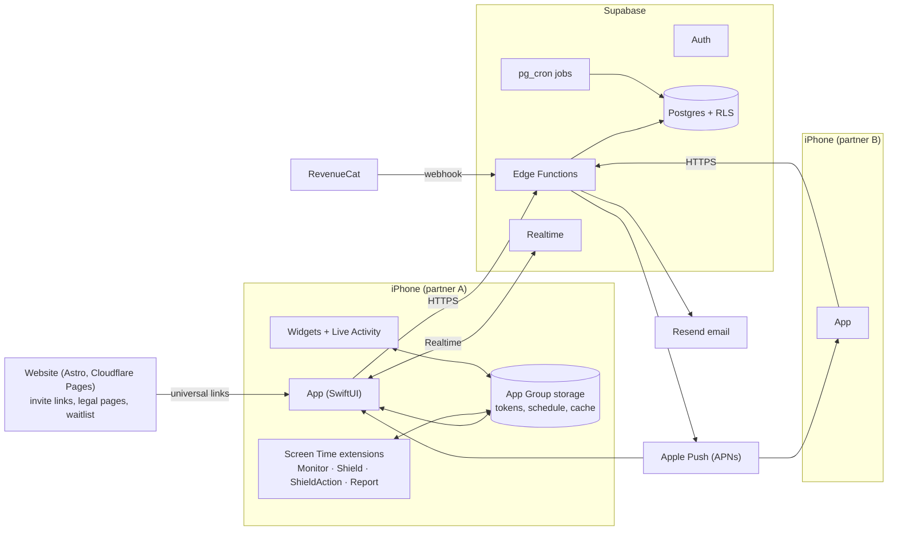
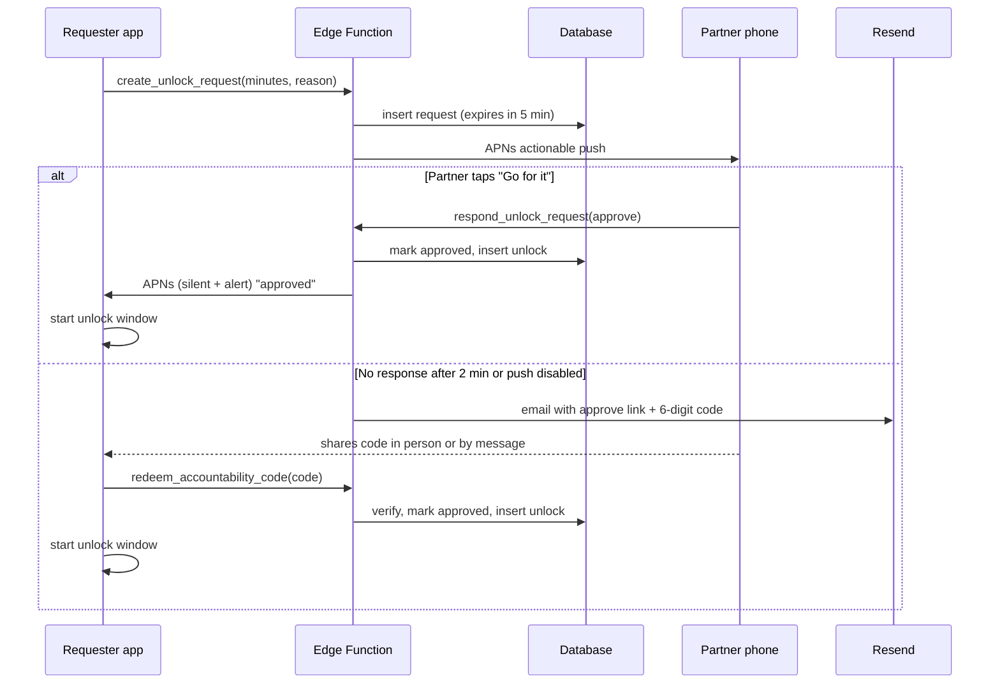

# 04 — Architecture

## 1. System overview

## 2. Components

### iPhone app (see `06-ios-app.md`)
- Main app: all UI, account, pairing, unlock flows, minutes, challenges, reports.
- **Device Activity Monitor extension:** applies and removes the pause (shields) when a schedule starts or ends and when an unlock window ends. This is the only code that runs at those moments, even if the app is closed.
- **Shield Configuration extension:** draws our custom pause screen.
- **Shield Action extension:** handles pause-screen buttons by posting a local notification.
- **Device Activity Report extension:** shows the user's own Screen Time usage privately. Its data cannot leave the extension.
- **Widget extension:** home/lock screen widgets and the unlock countdown Live Activity.
- **App Group:** shared container (`group.com.<company>.couplesapp`) holding the selection tokens, schedule, active unlock window and a small state cache, so extensions work without the network.

### Backend (Supabase)
- **Postgres** with Row Level Security: every table is readable and writable only by members of the pair it belongs to.
- **Auth:** Sign in with Apple and email magic link.
- **Edge Functions (TypeScript):** all actions that change minutes, pairs or requests go through functions, never direct table writes. This keeps the ledger trustworthy.
- **pg_cron:** expiring minutes nightly, expiring requests and invites, weekly report generation, the "minutes expire tomorrow" reminder, daily backup trigger.
- **Realtime:** live updates to the home screen (partner balance, request status).

### Services
- **APNs:** push, sent directly from Edge Functions with token-based (.p8 key) auth. Actionable categories for requests.
- **Resend:** email fallback for accountability codes, weekly report email (optional), waitlist confirmations.
- **RevenueCat:** StoreKit 2 purchases (Google Play later). Webhook updates the pair's premium status.
- **Website domain:** hosts universal links (`apple-app-site-association`) for invite links, privacy policy, terms, support and the waitlist.

## 3. Key flows

### 3.1 Protected time starts (no network needed)
1. At setup, the app registers a repeating Device Activity schedule (default 18:00–09:00).
2. At 18:00, iOS wakes the Monitor extension (`intervalDidStart`).
3. The extension reads the selection tokens from the App Group and applies shields with a named ManagedSettings store, plus "deny app removal".
4. At 09:00 (`intervalDidEnd`) it clears them.

> Verify in Phase 1 that a schedule crossing midnight fires correctly on iOS 17 and 18. Fallback: two schedules (18:00–23:59 and 00:00–09:00).

### 3.2 Unlock window
1. App receives an approved unlock (QR verified locally, or server says approved, or minutes spent).
2. App clears shields in the named store and starts a one-off Device Activity monitor named `unlock-<id>` running from now for N minutes (minimum 15).
3. App starts a Live Activity countdown.
4. When `unlock-<id>` ends, the Monitor extension re-applies shields if protected time is still active.

### 3.3 Ask your partner

### 3.4 In-person QR
- At pairing, the server generates a 160-bit secret per pair; each phone stores it in the Keychain (not the App Group).
- The showing phone renders a QR containing `pair_id`, the time-step counter and a 6-digit TOTP (RFC 6238, 30-second step, SHA-1, ±1 step tolerance).
- The scanning phone verifies with its own copy of the secret, rejects reused counters, starts the unlock and queues a `qr_unlock` event for sync.
- If the secret is compromised (lost phone), either partner can rotate it from Settings; the server pushes the new secret to both.

### 3.5 Premium
1. Purchase via RevenueCat on the payer's phone; RevenueCat app user ID = our user ID.
2. RevenueCat webhook → Edge Function updates `entitlements` for the payer.
3. A pair is premium if any current member has an active entitlement and is the covered partner's payer.
4. Both apps read pair premium from our database (not from RevenueCat directly) so the non-paying partner gets it.

## 4. Security

- All writes that affect minutes, requests, pairs, schedules-needing-approval or premium go through Edge Functions using the service role, after checking the caller's JWT and pair membership.
- Row Level Security on every table; clients can read their own pair's rows only.
- Accountability codes and invite codes are stored hashed (SHA-256 with a server pepper), single-use, rate-limited (5 attempts per request).
- QR secrets in the Keychain with `kSecAttrAccessibleAfterFirstUnlockThisDeviceOnly`.
- APNs key, Resend key, RevenueCat webhook secret: Supabase secrets only.
- Webhooks verified by signature/shared secret.

## 5. Privacy

- Never collected: which apps a user pauses, in-app content, location, contacts, Screen Time usage.
- Collected: account email, display name, optional photo, pair membership, schedules (times only), minute ledger, requests, challenges, kudos, notification tokens, product events without content.
- App Privacy label: data linked to the user for app functionality only; no tracking.
- Data export: JSON download from Settings. Deletion: §14 of the feature spec.

## 6. Environments

| Environment | Backend | App build |
|---|---|---|
| Local | Supabase CLI local stack | Xcode debug, mock blocking service in Simulator |
| Staging | Supabase free project #1 | TestFlight internal |
| Production | Supabase free project #2, upgraded to Pro before public launch | App Store |

Supabase Free allows 2 projects, which covers staging and production.

## 7. Backups (Supabase Free has none)

A scheduled GitHub Actions workflow (free) runs `pg_dump` against production nightly, encrypts it and stores it in a private storage location (for example a private GitHub repository release asset or Cloudflare R2 free tier). Keep 14 days. Test a restore before launch.

## 8. Cost at launch

| Item | Cost |
|---|---|
| Supabase | $0 (Free) until upgrade; $25/month on Pro |
| APNs, Realtime, Edge Functions | $0 within free limits |
| Resend | $0 up to 3,000 emails/month |
| RevenueCat | $0 up to $2,500 monthly revenue, then 1% |
| Cloudflare Pages | $0 |
| Domain | ~$10–20/year |
| Apple Developer Program | $99/year |
| Google Play | $25 one-time |
